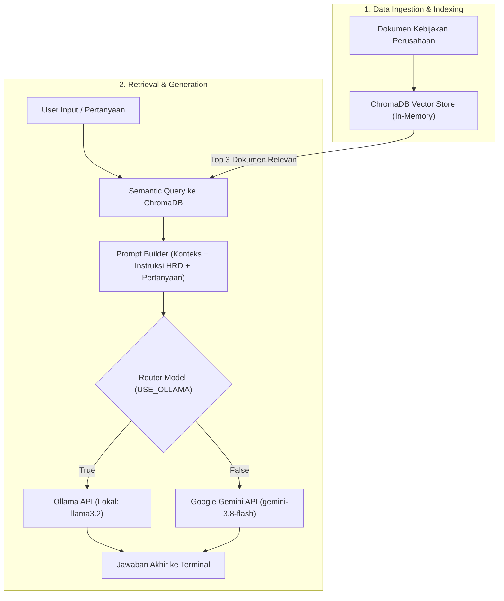

# AI RAG Practice - Asisten HRD Internal

Proyek ini adalah implementasi praktis **Retrieval-Augmented Generation (RAG)** sederhana menggunakan Python. Aplikasi ini bertindak sebagai chatbot asisten HRD internal kantor yang dapat menjawab pertanyaan karyawan seputar regulasi perusahaan (seperti aturan cuti, klaim reimbursement medis, perjalanan dinas, dan jam kerja) berdasarkan dokumen kebijakan yang disimpan dalam Vector Database.

Aplikasi ini mendukung dua pilihan engine Large Language Model (LLM):
1. **Ollama (Lokal & Gratis)** — Dijalankan secara offline di komputer Anda (default: `llama3.2`).
2. **Google Gemini API (Cloud)** — Menggunakan SDK resmi `google-genai` (default: `gemini-3.8-flash`).

---

## 🚀 Fitur Utama

- **Vector Database (ChromaDB)**: Menyimpan dan melakukan pencarian kemiripan semantik (*semantic similarity search*) secara *in-memory*.
- **Fleksibilitas LLM (Dual Engine)**: Kemudahan berpindah antara model lokal (Ollama) dan cloud (Google Gemini) hanya dengan mengubah satu baris konfigurasi.
- **Prompt Fleksibel Bahasa Indonesia**: Mampu mengenali sinonim dan padanan kata (misalnya "memesan tiket" dan "mengajukan tiket").
- **Pencegahan Halusinasi (Strict Fallback)**: Model diinstruksikan untuk menolak menjawab dan memberi tahu jika informasi tidak ditemukan di dokumen.
- **Mode Debug Retrieval**: Menampilkan potongan dokumen yang ditarik oleh Vector DB secara transparan sebelum jawaban digenerate.
- **Antarmuka CLI Interaktif**: Tanya-jawab langsung melalui terminal/command line.

---

## 📁 Struktur Direktori

```text
ai-rag-practice/
│
├── app.py              # Script utama aplikasi (ChromaDB, RAG logic, Ollama/Gemini integration)
├── requirements.txt    # Daftar dependensi Python
├── .env.example        # Template konfigurasi environment variable
├── .env                # File konfigurasi rahasia (API key) - tidak di-commit ke Git
├── .gitignore          # Mengabaikan venv dan file .env
└── README.md           # Dokumentasi proyek
```

---

## 🛠️ Prasyarat Sistem

1. **Python**: Versi 3.10 atau lebih baru.
2. **Pilihan Engine LLM**:
   - **Jika menggunakan mode Ollama**:
     - Unduh dan pasang [Ollama](https://ollama.com/).
     - Unduh model `llama3.2` melalui terminal:
       ```bash
       ollama pull llama3.2
       ```
     - Pastikan service Ollama berjalan di latar belakang (`http://localhost:11434`).
   - **Jika menggunakan mode Gemini API**:
     - Dapatkan API Key melalui [Google AI Studio](https://aistudio.google.com/).

---

## 📦 Panduan Instalasi & Setup

### 1. Buat dan Aktifkan Virtual Environment

**Windows (PowerShell):**
```powershell
python -m venv venv
.\venv\Scripts\Activate.ps1
```

**Windows (Command Prompt):**
```cmd
python -m venv venv
.\venv\Scripts\activate.bat
```

**Linux / macOS:**
```bash
python3 -m venv venv
source venv/bin/activate
```

### 2. Pasang Dependensi

```bash
pip install -r requirements.txt
```

Dependensi yang dipasang:
- `chromadb` — Vector database untuk indexing dan pencarian semantik.
- `google-genai` — SDK resmi Google Gemini Generative AI.
- `requests` — HTTP client untuk komunikasi ke Ollama API lokal.
- `python-dotenv` — Membaca environment variable dari file `.env`.

### 3. Konfigurasi Environment (`.env`)

Salin file `.env.example` menjadi `.env`:

**Windows (PowerShell):**
```powershell
Copy-Item .env.example .env
```

**Linux / macOS / Git Bash:**
```bash
cp .env.example .env
```

Buka file `.env` dan masukkan API Key Anda jika ingin menggunakan mode Gemini:
```env
GEMINI_API_KEY=AIzaSy...
```

---

## ⚙️ Pengaturan Mode Model (`app.py`)

Buka file `app.py` dan periksa bagian konfigurasi di bagian atas:

```python
# ==========================================================
# PENGATURAN MODE EKSEKUSI
# Set True untuk Ollama (Lokal/Gratis)
# Set False untuk Google Gemini API
# ==========================================================
USE_OLLAMA = True

OLLAMA_MODEL = "llama3.2"
GEMINI_MODEL = "gemini-3.8-flash"
```

- Jika `USE_OLLAMA = True`: Aplikasi akan memanggil Ollama di `http://localhost:11434`.
- Jika `USE_OLLAMA = False`: Aplikasi akan menggunakan Google Gemini API via key `GEMINI_API_KEY` di file `.env`.

---

## 💻 Cara Menjalankan Aplikasi

Jalankan script menggunakan Python:

```bash
python app.py
```

Setelah aplikasi berjalan, Anda akan melihat informasi bahwa Vector DB telah siap dan prompt input terminal akan muncul:

```text
[INFO] Vector DB Siap (4 dokumen terindeks). Engine aktif: Ollama (llama3.2)

Tanya ke Dokumen (atau ketik 'exit' untuk keluar): 
```

Ketik `exit` kapan saja untuk menghentikan program.

---

## 🧪 Contoh Pertanyaan Pengujian

Basis data saat ini memuat kebijakan dasar HRD. Anda dapat mencoba pertanyaan berikut:

| Kategori | Contoh Pertanyaan | Harapan Jawaban |
| :--- | :--- | :--- |
| **Cuti** | *"Berapa hari hak cuti tahunan saya?"* | 12 hari setelah masa kerja 1 tahun. |
| **Kesehatan** | *"Berapa plafon reimbursement rawat jalan?"* | Maksimal Rp5.000.000 per tahun per karyawan. |
| **Dinas** | *"Bagaimana aturan memesan tiket pesawat dinas?"* | Kelas ekonomi, dipesan minimal 7 hari sebelum keberangkatan. |
| **Jam Kerja** | *"Kantor buka dari jam berapa sampai jam berapa?"* | Senin - Jumat, 09.00 - 18.00 WIB. |
| **Di luar konteks** | *"Berapa bonus akhir tahun saya?"* | Menyatakan informasi tidak ditemukan di dokumen panduan. |

---

## 🧠 Alur Kerja RAG (Arsitektur)



---

## 📝 Menambahkan Dokumen Baru

Untuk memperluas basis pengetahuan dokumen, buka `app.py` lalu tambahkan baris teks baru pada list `dokumen`:

```python
dokumen = [
    "Aturan Cuti: Karyawan berhak atas 12 hari cuti tahunan setelah masa kerja 1 tahun.",
    "Reimbursement Medis: Batas klaim rawat jalan maksimal Rp5.000.000 per tahun per karyawan.",
    "Prosedur Perjalanan Dinas: Tiket pesawat kelas ekonomi harus dipesan minimal 7 hari sebelum keberangkatan.",
    "Jam Kerja: Jam operasional kantor adalah Senin sampai Jumat, pukul 09.00 hingga 18.00 WIB.",
    # Tambahkan dokumen baru di sini:
    "Waktu Istirahat: Istirahat siang berlangsung selama 1 jam dari pukul 12.00 hingga 13.00 WIB.",
]
```
Jalankan ulang `python app.py` untuk mengindeks dokumen terbaru.
